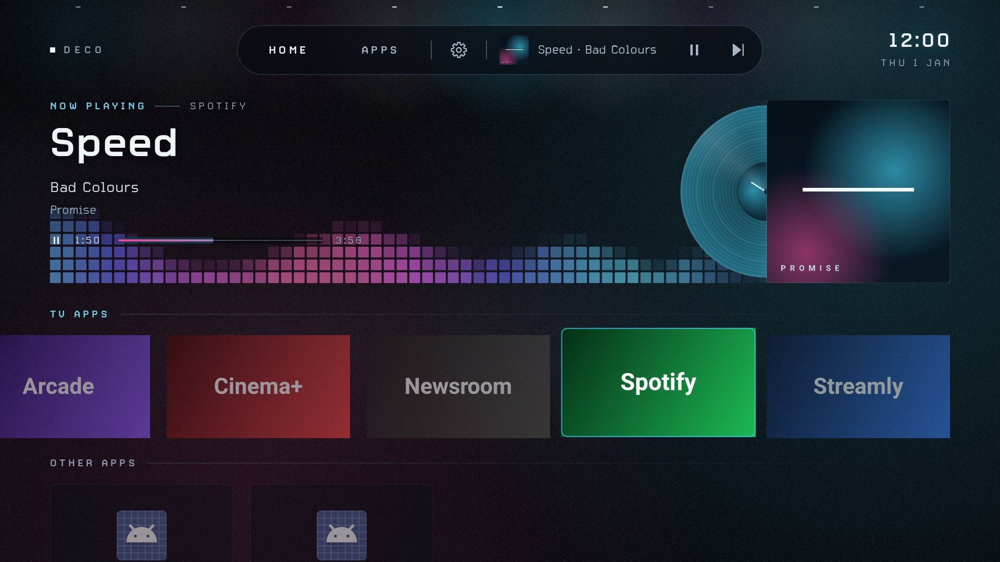
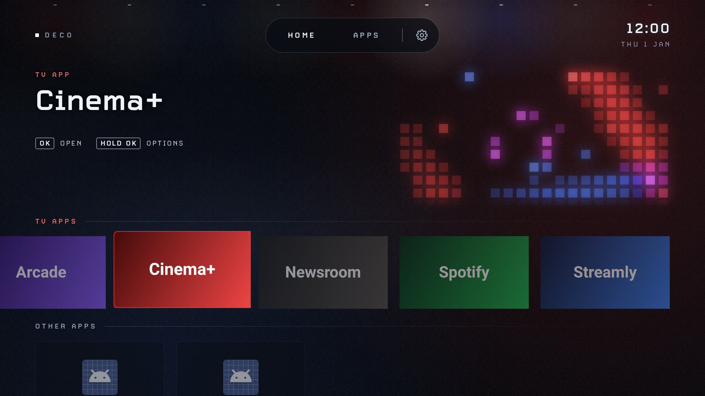
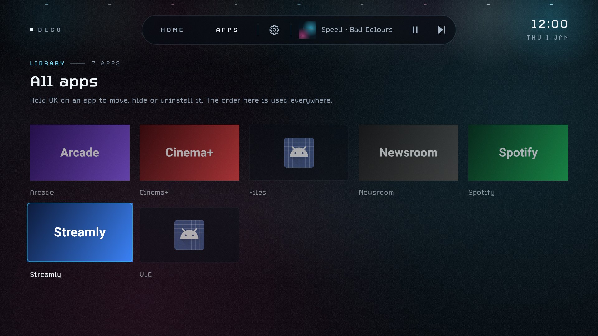

# Deco Launcher

A lightweight home screen for the Chromecast with Google TV and other Android TV
devices. No ads, no sponsored rows, no accounts, and no internet: it doesn't even ask for
internet access. The APK is about 400 KB.



*Previews rendered with made-up apps. On your TV, each card shows the app's own banner, and the
light takes each app's own colours.*

## Design

**Light in fog.** The whole launcher sits on a dark stage in haze, after Justice's IRIS light shows
(sharp lights cutting through heavy fog) with the restraint of Blade Runner 2049's screens
(hairlines, few elements, a lot of empty space).

- **Every light has two parts:** a sharp core drawn at full detail, and a soft glow drawn at 1/8
  of the screen's size and stretched across it, so it spreads like light in fog. Fog banks drift
  slowly behind everything and keep moving even when the music stops. A fine grain keeps the haze
  smooth.
- **Two colours and white, never more.** Each screen has a *key* light, taken from what's in focus
  (the album cover playing, or the focused app's own colour), and a *fill* that answers it low
  from the opposite corner: cyan meets magenta, red meets blue, amber meets teal, green meets
  violet. Grey art gets cyan and magenta.
- **The background is a quiet light show,** the same on Home and Apps. Two big washes of the key
  and fill drift slowly and swell a little with the bass, and a row of small lamps far overhead
  runs a slow chase, like a lighting rig seen through haze.
- **Layout after the Apple TV app.** The focused app fills the hero: its name on the left and a
  wall of lamps on the right; music shows its album cover as an LP on the right with the
  visualizer beside it; a playing video shows its thumbnail full-screen. A glass pill of
  tabs sits at the top, the DECO mark on the left and the clock on the right. Rows of glass cards
  run along the bottom, and the next row peeks in.
- **Every app gets a wall of lamps** in its own light, where an album cover would be: a slow
  sweep in the key colour crosses a slower wave in the fill, and now and then a lamp flares white.
  Each lamp is sharp with a soft round glow, the bottom row shows faintly on the floor, and the
  wall fades in from the left, clear of the text. Streaming apps get it too, instead of show
  previews.
- **Small labels** say what the hero shows, in spaced-out capitals with a hairline:
  NOW PLAYING — SPOTIFY, RECENTLY PLAYED — SPOTIFY, or TV APP above an app's name. Row titles have a hairline
  that fades out to the right, and light up in the key colour while one of their cards has focus.
- **Focus is the brightest thing on screen.** The focused card lifts a little, with a thin edge
  in the key colour and a glow of the key above it and the fill below; the other cards step back
  to half strength. In the top bar and menus, focus is a touch of light on the glass with a thin
  cyan edge; the current tab is simply the brighter one.
- **Icons are thin lines** (1.6 on a 24 grid, rounded joins); only the play controls are filled.
- **Type is Carbon+**, the same as Worldly and SAB Monitor: bold for titles, labels and the clock.
  Colours: night `#05070B`, panels `#0B1220`, text `#EEF4F8` / `#C9D4DD` / `#8FA0B3`, hairlines at
  12% cyan, LED cores `#ECF6FF`.

| An app in focus | Apps page | Settings |
|---|---|---|
|  |  |  |

### Icon


Part of the same icon family as Worldly and SAB Monitor: the graphite rounded square with the
slanted slate street-map grid, vignette and thin border, and a dark disc with an amber ring.
Deco's emblem is an amber TV showing a grid of app tiles. The focused tile is amber with the
family's white ring, and the cyan, green and yellow dots are the family's accent dots.

- It's an adaptive icon, so it works in any shape the system uses (circle, rounded square), and it
  has a one-colour layer for Android's themed icons.
- The TV banner (what Google TV shows in its apps row) uses the same art with "Deco" in Carbon+.
- The sources are the SVGs in [`assets/`](assets). To redraw the PNG/WebP files after editing
  them, run `node assets/render-icons.js && python3 assets/to-webp.py` (needs Playwright with
  Chromium, and Pillow).

## What it does

- **Home tab:** two rows of cards, **TV apps** and **Other apps** (phone apps), with nothing
  written under them. The Apps tab names each app.
- **Mini player** in the top bar while something plays (see [Now playing](#now-playing))
- **Apps tab:** every app in a 5-column grid. The order you set here is used everywhere.
- **Hold OK on a card** (or press Menu on remotes that have one):
  - **Move** (Apps tab): use the arrows to slide the card, then press OK
  - **Hide**, **App info**, **Uninstall**
- **Play Store** (the bag icon) opens Google Play; it only shows when the Play Store is
  installed. **⚙ Settings** has the TV's own settings first, then hidden apps, Now playing setup,
  the audio visualizer on/off, and Home button setup.
- **Up** from the top row, or **Back** from anywhere, goes to the tabs. Back on the Apps tab goes
  to Home. Focus coming up from the cards always lands on the current tab.
- **Home** while already home jumps back to the top.
- **Play/pause** on the remote controls what's playing.
- **Updates by itself** when apps are installed, removed, updated or disabled.
- **English and Spanish:** it follows the TV's language (Settings → System → Language) and
  switches by itself when you change it.

## Now playing

While Spotify, YouTube (or any app with standard media controls) is playing or paused, a small
player appears in the top bar, after Home / Apps / Play Store / ⚙: the cover, "title · artist", play/pause
and next. OK on the cover opens the player. On the player, and on the playing app's own card, the
hero shows what's playing: Spotify's cover as an LP lit in its own colours, with how far through the song it is, or a
YouTube video's thumbnail full-screen.

**Recently played.** When nothing is playing, Spotify's (and any music app's) card shows what you
last played in it, taking turns every 8 seconds: the cover as an LP in its sleeve, title, artist
and when. Video thumbnails aren't shown, so video apps keep their wall of lamps. The launcher notes each track or video as it plays, even while you're in another app, and
keeps the last 8 per app with their covers on the TV only (nothing is sent anywhere). It needs the
same notification access as the mini player, and fills up as you play things.

Android only shows other apps' media to apps with notification access, and Android TV has no
screen to turn that on, so do it once from Termux:

```bash
adb shell cmd notification allow_listener com.camdeco.launcher/com.camdeco.launcher.MediaListenerService
```

Go back to Home and start some music. **⚙ Settings → Now playing** shows whether access is on. To turn it
off, run the same command with `disallow_listener`.

### The record

The album cover is shown as an LP: the cover is the sleeve. When the song plays, the record slides
out to the left and spins at 33⅓ rpm; on pause it slows to a stop. When the song changes, the
record stops, slides back into the sleeve, the sleeve changes to the new cover, and the new record
slides out and spins. The record is tinted from the cover, with grooves and the cover art on its
label. Recently played songs show their LP with the record in the sleeve.

Players often resend the song they're playing, sometimes with a new copy of the cover or for a
moment without one, and some drop out for a split second between songs. Deco goes by the song
itself (app, title, artist and album), not the picture, and waits 1.5 seconds before deciding
something has stopped, so none of that sends the record back into its sleeve or flickers the
mini player.

### Audio visualizer

While the hero shows what's playing, light cells show the music, like a hi-fi spectrum display: 48
columns, from the bass on the left (40 Hz) through voices in the middle to the treble on the right
(16 kHz). The grid is level with the album cover (same top and bottom), sits behind the song's text,
and runs from the screen margin to the cover, trailing off as it passes behind the record. Only
cells with sound light up; they're see-through, so the cover's glow shows through them, fade more
toward the top so the text stays easy to read, and each bar's top cell is a little softer still. Each column rises with its part of the music and settles back gently, and the top
cell of a column fades in and out, so the heights change smoothly. The cells take the album
cover's colours: bands of its key and fill colour drift slowly across the panel, blending round
the colour wheel between them so they never turn grey. Cells are a little whiter at the bottom,
have no glow of their own so they never blow out over the haze, and go dark on pause.

All columns share one volume scale, so a bassy song lights mostly the left and a sung part mostly
the middle. Higher columns get lifted to make up for music naturally carrying far more energy in
the bass.

To follow the real song, Deco listens to what the TV plays through Android's audio visualizer.
Android files that under the microphone permission ("record audio"), but Deco only reads the TV's
own sound, at low detail, and never opens a microphone. Allow it from **⚙ Settings → Audio visualizer** (the
TV asks once), or from Termux:

```bash
adb shell pm grant com.camdeco.launcher android.permission.RECORD_AUDIO
```

**⚙ Settings → Audio visualizer** says what the cells are doing on your TV:

- **it follows the music**: Deco hears the TV's sound.
- **it moves on its own**: Deco isn't allowed to listen, or the TV keeps its sound private (some
  TVs give apps only silence). The cells still move while music plays and go dark on pause, but
  they don't follow the song.

The same menu turns the visualizer off. It only runs while it's on screen, so it costs nothing
otherwise.

## Install

One APK works on the Chromecast with Google TV **HD** and **4K**, and on any Android TV running
Android 8.0 or later. Install the same file on each TV. It has no native code, and its layout is
measured in screen-independent units, so it looks the same on a 1080p and a 4K screen.

From Termux on your phone (see the main README for setting up `adb`):

```bash
curl -LO https://github.com/daveroz/Cam-deco/releases/download/launcher-latest/DecoLauncher.apk
adb connect 192.168.x.x:5555
adb install -r DecoLauncher.apk
```

That link always points to the latest build from GitHub Actions (see [Building](#building)).

Then open **Deco Launcher** from the Google TV apps list to try it out.

## Make the Home button open it

On a Chromecast, Google TV keeps the Home button for itself. There are two ways
around that. Try the launcher for a while before using either.

### Option 1: Home button override (keeps Google TV installed)

On the TV, go to **Settings → System → Accessibility → Deco Launcher Home button**
and turn it on. If the switch is greyed out, run this instead:

```bash
adb shell settings put secure enabled_accessibility_services com.camdeco.launcher/com.camdeco.launcher.HomeButtonService
adb shell settings put secure accessibility_enabled 1
```

The first command replaces the list of enabled accessibility services. Any other
accessibility service you had on, such as TalkBack, gets turned off.

Each time Google TV's home screen appears, Deco Launcher opens on top of it, so
Google TV may flash for a moment. Panels that Google TV itself opens (from its
home screen app) will also bounce back to Deco Launcher. The service only
watches Google TV's windows and doesn't read anything on screen.

### Option 2: Turn off Google TV (frees the most memory)

The HD model only has 1.5 GB of RAM (the 4K has 2 GB), and Google TV's home screen is the biggest
thing running on it.
The safest way to turn it off is the script in this repo, which makes Deco Launcher Home first,
turns off only the Google TV home screen, checks Home, WiFi, Settings, casting and the rest, and
puts Google TV back by itself if anything goes wrong:

```bash
curl -LO https://raw.githubusercontent.com/daveroz/Cam-deco/ccr-beaea807-gbu79w/scripts/disable-google-tv.sh
bash disable-google-tv.sh 192.168.x.x
```

By hand, in the TV's own command line (or with `adb shell "..."` in front), this one line does
the same and was confirmed on a Chromecast HD. The 4K runs the same Google TV, so use the same line
there. It stops if Deco Launcher isn't installed, and puts Google TV back if Home doesn't open
Deco Launcher:

```
[ -n "$(pm path com.camdeco.launcher)" ] && { cmd package set-home-activity --user 0 com.camdeco.launcher/com.camdeco.launcher.HomeActivity; pm disable-user --user 0 com.google.android.apps.tv.launcherx; pm disable-user --user 0 com.google.android.tungsten.setupwraith; input keyevent KEYCODE_HOME; sleep 5; if dumpsys window | grep mCurrentFocus | grep -q com.camdeco.launcher; then echo "OK: Home opens Deco Launcher"; else echo "Home opened: $(dumpsys window | grep mCurrentFocus)"; pm enable com.google.android.apps.tv.launcherx; pm enable com.google.android.tungsten.setupwraith; echo "Google TV is back on"; fi; } || echo "STOP: Deco Launcher is not installed, nothing was changed"
```

Why the setup app goes too: on a Chromecast with Google TV, four apps can be Home, in this order:
Google TV's home screen (priority 2), Google TV setup's **recovery screen** (`setupwraith`,
priority 1), Deco Launcher (0) and Android's fallback (−1000). With only the home screen off, the
Home button lands on the recovery screen instead of Deco Launcher. (Android doesn't let the
command line turn off just that one screen, only the whole setup app.) To see the list:
`cmd package query-activities --brief -a android.intent.action.MAIN -c android.intent.category.HOME`

To undo:

```bash
bash disable-google-tv.sh 192.168.x.x --undo
# or in the TV's command line:
#   pm enable com.google.android.apps.tv.launcherx; pm enable com.google.android.tungsten.setupwraith
```

**Keep the undo command.** If Deco Launcher is ever uninstalled while Google TV is off, the Home
button does nothing until you run it. With Google TV off, its own features (profiles, the For You
tab, recommendations) are gone. Casting, voice search, Settings and the Play Store are separate
apps and keep working; the script checks them.

## Updating

Download the latest APK again and install it over the old one with `adb install -r DecoLauncher.apk`.
Hidden apps and the order are kept.

Android only installs an update that is signed with the same key as the version already on the TV.
Every build on the `launcher-latest` release is signed with the same key, so they install over each
other. Only install from that link: the **DecoLauncher.apk** artifacts of early GitHub runs (before
the signing key was set up) used a different key.

If the TV says **"package conflicts with an existing package"** (or adb says
`INSTALL_FAILED_UPDATE_INCOMPATIBLE`), the copy on the TV has a different key. Replace it once,
making sure the TV keeps a home screen meanwhile (this resets hidden apps and the order):

```bash
adb shell pm enable com.google.android.apps.tv.launcherx   # a home screen while Deco is away
adb uninstall com.camdeco.launcher
adb install DecoLauncher.apk
bash disable-google-tv.sh 192.168.x.x                      # Deco Launcher as Home again
```

## Building

### On GitHub

[`.github/workflows/build.yml`](../.github/workflows/build.yml) runs on every push that changes
`launcher/`, and from **Actions → Build APK → Run workflow**. It runs the tests, builds the release
APK, uploads it as the **DecoLauncher.apk** artifact and, on the default branch, publishes it to the
[`launcher-latest`](https://github.com/daveroz/Cam-deco/releases/tag/launcher-latest) release. The
run's summary shows the version and the signing key's SHA-256 fingerprint.

The signing key lives in one repository secret: **Settings → Secrets and variables → Actions →
New repository secret**, named `DECO_KEYSTORE_BASE64`, holding the keystore file encoded with
`base64 -w0`. It's a standard debug-style keystore (password `android`, alias `androiddebugkey`);
for a different keystore, also add `DECO_KEYSTORE_PASSWORD`, `DECO_KEY_ALIAS` and
`DECO_KEY_PASSWORD`. Without the secret, builds still run but are signed with a throwaway key and
aren't published to the release.

### On your own computer

Needs JDK 21 and the Android SDK with platform 36.

```bash
./gradlew testReleaseUnitTest    # Robolectric tests that drive the launcher with remote key presses
./gradlew assembleRelease        # app/build/outputs/apk/release/app-release.apk
```

To sign with the fixed key, point `DECO_KEYSTORE_FILE` at the keystore file first; otherwise the
build uses your computer's debug key.
