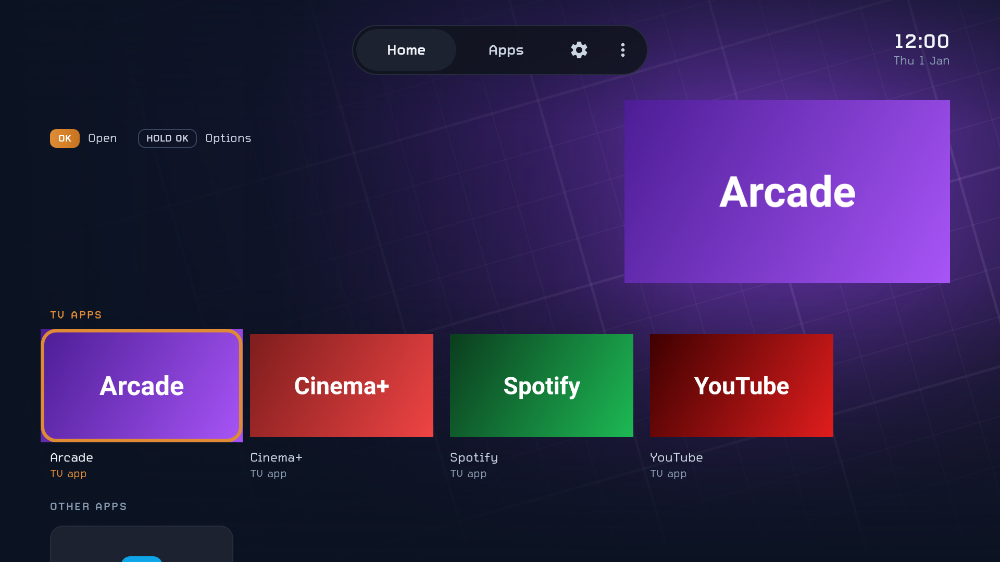
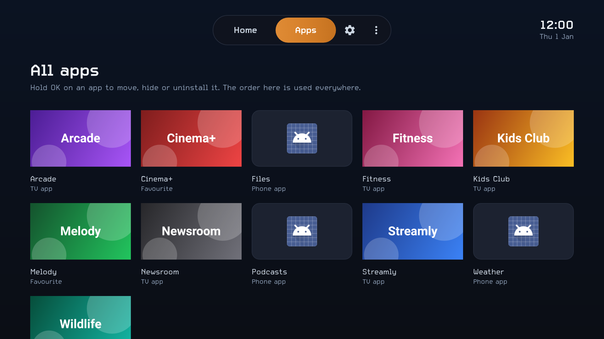
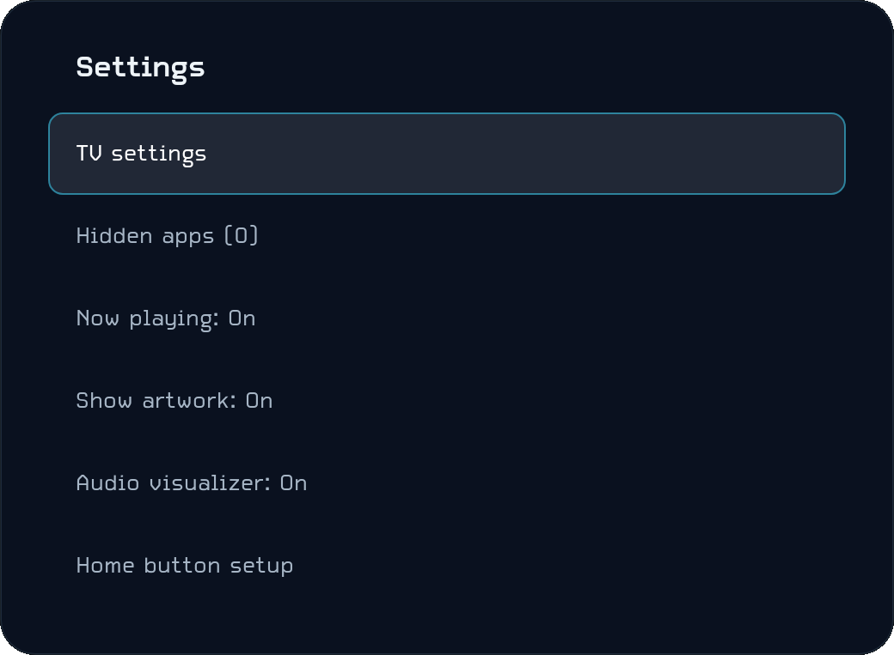
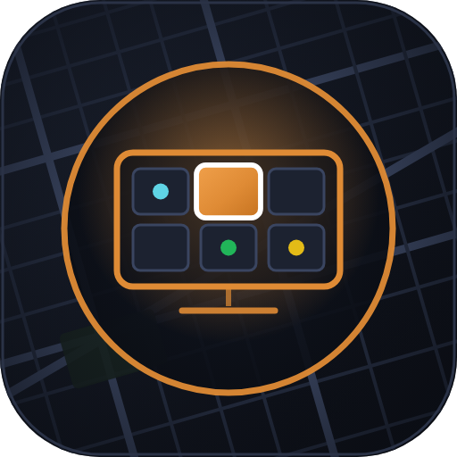

# Deco Launcher

A lightweight home screen for the Chromecast with Google TV and other Android TV
devices. No ads, no sponsored rows, no accounts. The only thing it fetches from the internet
is public show info and artwork from TVmaze (see [Show artwork](#show-artwork)), which you can
turn off. The APK is about 400 KB.



*Previews rendered with made-up apps. On your TV, each card and the hero show the app's own banner.*

## Design

- **Layout after the Apple TV app.** The focused app fills the screen as the hero. Streaming apps
  show their shows full-screen with a big title on the left. Music shows its album cover as a
  rounded card on the right with the cover's blur across the whole screen; videos show their
  thumbnail full-screen. A pill of tabs sits at the top with the clock on the right. Rows of cards
  run along the bottom, and the next row peeks in. Moving down scrolls the rows up and fades the
  hero away.
- **Apps with nothing else to show glow in their own colours.** The launcher picks the app's
  two most characteristic colours from its banner or icon: a bright one glows behind the card on
  the right, a deep one washes in from the top, and the slanted street-map grid of the icon
  family (Worldly, SAB Monitor, Deco) is drawn faintly over them. Moving between apps blends one
  app's colours into the next. Grey or white logos get Worldly's amber and slate instead.
- **The card on the right** (a banner, an icon or an album cover) lines up with the title on the
  left, keeps clear of the top bar, ends at the same screen margin as the clock, and stops above
  the first row.
- **Look from Worldly.** Graphite surfaces (`#0B1322`, `#11141E`, `#1C2230`), thin slate borders
  (`#252C3C`), and one amber accent (`#DF8B35`) for focus rings, the focused tab and menu rows
  (as Worldly's amber gradient) and the active row title. The type is Worldly's Carbon+:
  regular for text, bold for titles and the clock. Corner radii are 12 for cards and 28 for menus.

| Apps page | App menu |
|---|---|
|  |  |

### Icon



Part of the same icon family as Worldly and SAB Monitor: the graphite rounded square with the
slanted slate street-map grid, vignette and thin border, and a dark disc with an amber ring.
Deco's emblem is an amber TV showing a grid of app tiles. The focused tile is amber with the
family's white ring, and the cyan, green and yellow dots are the family's accent dots.

- It's an adaptive icon, so it works in any shape the system uses (circle, rounded square), and it
  has a one-colour layer for Android's themed icons.
- The TV banner (what Google TV shows in its apps row) uses the same art with "Deco" in Carbon+.
- The sources are the SVGs in [`assets/`](assets). To redraw the PNG/WebP files after editing
  them, run `node assets/render-icons.js && python3 assets/to-webp.py` (needs Playwright with
  Chromium, and Pillow).

## What it does

- **Home tab:** two rows, **TV apps** and **Other apps** (phone apps)
- **Mini player** in the top bar while something plays (see [Now playing](#now-playing))
- **Streaming apps show their shows:** focus Netflix, Disney+, Prime Video, HBO Max, Hulu,
  Apple TV, Paramount+ or Peacock and the hero fills with that service's shows, changing every
  8 seconds (see [Show artwork](#show-artwork))
- **Apps tab:** every app in a 5-column grid. The order you set here is used everywhere.
- **Hold OK on a card** (or press Menu on remotes that have one):
  - **Move** (Apps tab): use the arrows to slide the card, then press OK
  - **Hide**, **App info**, **Uninstall**
- **Play Store** (the bag icon) opens Google Play; it only shows when the Play Store is
  installed. **⚙** opens Android TV settings. **⋮** has hidden apps, Now playing setup, show artwork on/off
  and Home button setup.
- **Up** from the top row, or **Back** from anywhere, goes to the tabs. Back on the Apps tab goes
  to Home. Focus coming up from the cards always lands on the current tab.
- **Home** while already home jumps back to the top.
- **Play/pause** on the remote controls what's playing.
- **Updates by itself** when apps are installed, removed, updated or disabled.
- **English and Spanish:** it follows the TV's language (Settings → System → Language) and
  switches by itself when you change it. Show titles and descriptions come from TVmaze, which only
  has them in English.

## Now playing

While Spotify, YouTube (or any app with standard media controls) is playing or paused, a small
player appears in the top bar, after Home / Apps / Play Store / ⚙ / ⋮: the cover, "title · artist", play/pause
and next. OK on the cover opens the player. On the player, and on the playing app's own card, the
hero shows what's playing: Spotify's cover as a large card with its blur filling the screen, or a
YouTube video's thumbnail full-screen.

**Recently played.** When nothing is playing, Spotify's, YouTube's (and any media app's) card shows
what you last played in it, taking turns like the streaming apps' shows: cover, title, artist and
when. The launcher notes each track or video as it plays, even while you're in another app, and
keeps the last 8 per app with their covers on the TV only (nothing is sent anywhere). It needs the
same notification access as the mini player, and fills up as you play things.

Android only shows other apps' media to apps with notification access, and Android TV has no
screen to turn that on, so do it once from Termux:

```bash
adb shell cmd notification allow_listener com.camdeco.launcher/com.camdeco.launcher.MediaListenerService
```

Go back to Home and start some music. **⋮ → Now playing** shows whether access is on. To turn it
off, run the same command with `disallow_listener`.

### Sound wave

While the hero shows what's playing, a line under the song moves with the music: it takes the
album cover's colours, ripples with the bass and treble, and goes flat on pause.

To follow the real song, Deco listens to what the TV plays through Android's audio visualizer.
Android files that under the microphone permission ("record audio"), but Deco only reads the TV's
own sound, at low detail, and never opens a microphone. Allow it from **⋮ → Sound wave** (the TV
asks once), or from Termux:

```bash
adb shell pm grant com.camdeco.launcher android.permission.RECORD_AUDIO
```

**⋮ → Sound wave** says what the line is doing on your TV:

- **it follows the music**: Deco hears the TV's sound.
- **it moves on its own**: Deco isn't allowed to listen, or the TV keeps its sound private (some
  TVs give apps only silence). The line still moves while music plays and rests on pause, but it
  doesn't follow the beat.

The same menu turns the wave off. It only runs while it's on screen, so it costs nothing otherwise.

## Show artwork

Netflix, Disney+ and the other services only share their own recommendations with Google's
built-in launcher. So instead, Deco Launcher uses [TVmaze](https://www.tvmaze.com)'s free public
API (no account or key): twice a day it fetches the past week's new streaming episodes, keeps each
service's most popular shows, and downloads their backgrounds once (shrunk to TV size, about 40 MB
of cache at most). The hero then shows the show's name, genres, latest episode and summary, with
"Show info from TVmaze" as credit (TVmaze's data is CC BY-SA).

It covers TV shows with new episodes that week, not films. Turn it off with **⋮ → Show artwork**;
then streaming apps show their own banner like every other app and nothing is downloaded.

## Install

One APK works on the Chromecast with Google TV **HD** and **4K**, and on any Android TV running
Android 8.0 or later. Install the same file on each TV. It has no native code, and its layout is
measured in screen-independent units, so it looks the same on a 1080p and a 4K screen.

From Termux on your phone (see the main README for setting up `adb`):

```bash
curl -LO https://github.com/daveroz/Cam-deco/releases/download/launcher-latest/DecoLauncher.apk
adb connect 192.168.x.x:5555
adb install -r DecoLauncher.apk
```

That link always points to the latest build from GitHub Actions (see [Building](#building)).

Then open **Deco Launcher** from the Google TV apps list to try it out.

## Make the Home button open it

On a Chromecast, Google TV keeps the Home button for itself. There are two ways
around that. Try the launcher for a while before using either.

### Option 1: Home button override (keeps Google TV installed)

On the TV, go to **Settings → System → Accessibility → Deco Launcher Home button**
and turn it on. If the switch is greyed out, run this instead:

```bash
adb shell settings put secure enabled_accessibility_services com.camdeco.launcher/com.camdeco.launcher.HomeButtonService
adb shell settings put secure accessibility_enabled 1
```

The first command replaces the list of enabled accessibility services. Any other
accessibility service you had on, such as TalkBack, gets turned off.

Each time Google TV's home screen appears, Deco Launcher opens on top of it, so
Google TV may flash for a moment. Panels that Google TV itself opens (from its
home screen app) will also bounce back to Deco Launcher. The service only
watches Google TV's windows and doesn't read anything on screen.

### Option 2: Turn off Google TV (frees the most memory)

The HD model only has 1.5 GB of RAM (the 4K has 2 GB), and Google TV's home screen is the biggest
thing running on it.
The safest way to turn it off is the script in this repo, which makes Deco Launcher Home first,
turns off only the Google TV home screen, checks Home, WiFi, Settings, casting and the rest, and
puts Google TV back by itself if anything goes wrong:

```bash
curl -LO https://raw.githubusercontent.com/daveroz/Cam-deco/ccr-beaea807-gbu79w/scripts/disable-google-tv.sh
bash disable-google-tv.sh 192.168.x.x
```

By hand, in the TV's own command line (or with `adb shell "..."` in front), this one line does
the same and was confirmed on a Chromecast HD. The 4K runs the same Google TV, so use the same line
there. It stops if Deco Launcher isn't installed, and puts Google TV back if Home doesn't open
Deco Launcher:

```
[ -n "$(pm path com.camdeco.launcher)" ] && { cmd package set-home-activity --user 0 com.camdeco.launcher/com.camdeco.launcher.HomeActivity; pm disable-user --user 0 com.google.android.apps.tv.launcherx; pm disable-user --user 0 com.google.android.tungsten.setupwraith; input keyevent KEYCODE_HOME; sleep 5; if dumpsys window | grep mCurrentFocus | grep -q com.camdeco.launcher; then echo "OK: Home opens Deco Launcher"; else echo "Home opened: $(dumpsys window | grep mCurrentFocus)"; pm enable com.google.android.apps.tv.launcherx; pm enable com.google.android.tungsten.setupwraith; echo "Google TV is back on"; fi; } || echo "STOP: Deco Launcher is not installed, nothing was changed"
```

Why the setup app goes too: on a Chromecast with Google TV, four apps can be Home, in this order:
Google TV's home screen (priority 2), Google TV setup's **recovery screen** (`setupwraith`,
priority 1), Deco Launcher (0) and Android's fallback (−1000). With only the home screen off, the
Home button lands on the recovery screen instead of Deco Launcher. (Android doesn't let the
command line turn off just that one screen, only the whole setup app.) To see the list:
`cmd package query-activities --brief -a android.intent.action.MAIN -c android.intent.category.HOME`

To undo:

```bash
bash disable-google-tv.sh 192.168.x.x --undo
# or in the TV's command line:
#   pm enable com.google.android.apps.tv.launcherx; pm enable com.google.android.tungsten.setupwraith
```

**Keep the undo command.** If Deco Launcher is ever uninstalled while Google TV is off, the Home
button does nothing until you run it. With Google TV off, its own features (profiles, the For You
tab, recommendations) are gone. Casting, voice search, Settings and the Play Store are separate
apps and keep working; the script checks them.

## Updating

Download the latest APK again and install it over the old one with `adb install -r DecoLauncher.apk`.
Hidden apps and the order are kept.

Android only installs an update that is signed with the same key as the version already on the TV.
Every build on the `launcher-latest` release is signed with the same key, so they install over each
other. Only install from that link: the **DecoLauncher.apk** artifacts of early GitHub runs (before
the signing key was set up) used a different key.

If the TV says **"package conflicts with an existing package"** (or adb says
`INSTALL_FAILED_UPDATE_INCOMPATIBLE`), the copy on the TV has a different key. Replace it once,
making sure the TV keeps a home screen meanwhile (this resets hidden apps and the order):

```bash
adb shell pm enable com.google.android.apps.tv.launcherx   # a home screen while Deco is away
adb uninstall com.camdeco.launcher
adb install DecoLauncher.apk
bash disable-google-tv.sh 192.168.x.x                      # Deco Launcher as Home again
```

## Building

### On GitHub

[`.github/workflows/build.yml`](../.github/workflows/build.yml) runs on every push that changes
`launcher/`, and from **Actions → Build APK → Run workflow**. It runs the tests, builds the release
APK, uploads it as the **DecoLauncher.apk** artifact and, on the default branch, publishes it to the
[`launcher-latest`](https://github.com/daveroz/Cam-deco/releases/tag/launcher-latest) release. The
run's summary shows the version and the signing key's SHA-256 fingerprint.

The signing key lives in one repository secret: **Settings → Secrets and variables → Actions →
New repository secret**, named `DECO_KEYSTORE_BASE64`, holding the keystore file encoded with
`base64 -w0`. It's a standard debug-style keystore (password `android`, alias `androiddebugkey`);
for a different keystore, also add `DECO_KEYSTORE_PASSWORD`, `DECO_KEY_ALIAS` and
`DECO_KEY_PASSWORD`. Without the secret, builds still run but are signed with a throwaway key and
aren't published to the release.

### On your own computer

Needs JDK 21 and the Android SDK with platform 36.

```bash
./gradlew testReleaseUnitTest    # Robolectric tests that drive the launcher with remote key presses
./gradlew assembleRelease        # app/build/outputs/apk/release/app-release.apk
```

To sign with the fixed key, point `DECO_KEYSTORE_FILE` at the keystore file first; otherwise the
build uses your computer's debug key.
